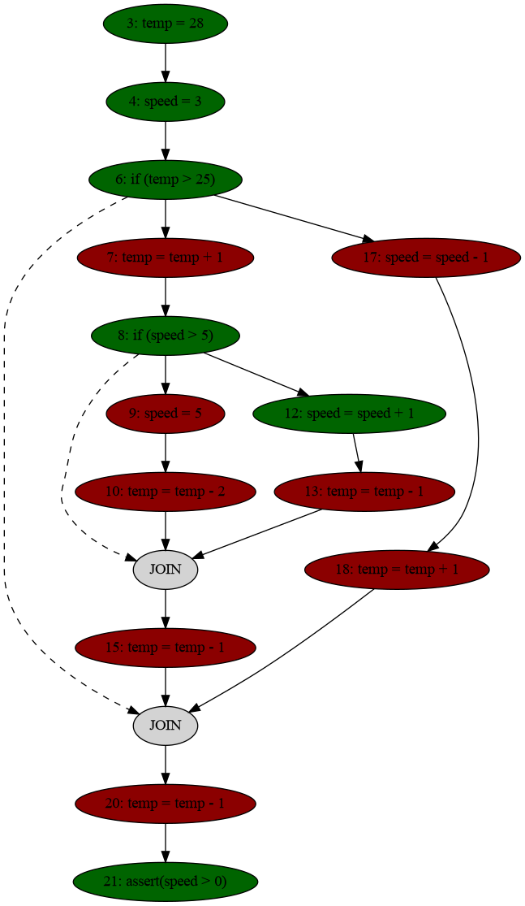

<p align="right">
  <picture>
    <source media="(prefers-color-scheme: dark)" srcset="img/richtesting-dark.svg">
    
  </picture>
</p>

<p align="center">
  <picture>
    <source media="(prefers-color-scheme: dark)" srcset="img/proofcov-dark.svg">
    
  </picture>
</p>

<p align="center">
  <em>Coverage of what your assertions actually check, not just what your tests execute.</em>
</p>

# proofcov tutorial

> This tutorial walks you through installing proofcov, running it on a few
> example programs and reading what it prints. The commands assume you are in the root of
> the repository.

## Contents

1. [What is proof coverage?](#1-what-is-proof-coverage)
2. [Installation](#2-installation)
3. [Your first run](#3-your-first-run)
4. [Understanding the output](#4-understanding-the-output)
5. [Looking inside: verbose mode](#5-looking-inside-verbose-mode)
6. [Drawing the control flow graph](#6-drawing-the-control-flow-graph)
7. [More than one proof: `--enumerate-cores`](#7-more-than-one-proof---enumerate-cores)
8. [When the assertion can fail](#8-when-the-assertion-can-fail)
9. [Which programs are supported?](#9-which-programs-are-supported)
10. [Command-line reference](#10-command-line-reference)
11. [Running the tests](#11-running-the-tests)
12. [Further reading](#12-further-reading)

---

## 1. What is proof coverage?

Classical coverage metrics such as line coverage tell you which statements a test
*executes*. A statement can be executed without its result ever being checked. Here is a
simple fan controller with a test assertion at the end
([`examples/fan.c`](../examples/fan.c)):

```c
 1  void main() {
 2      int temp, speed;
 3      temp = 28;
 4      speed = 3;
 5
 6      if (temp > 25) {
 7          temp = temp + 1;
 8          if (speed > 5) {
 9              speed = 5;
10              temp = temp - 2;
11          } else {
12              speed = speed + 1;
13              temp = temp - 1;
14          }
15          temp = temp - 1;
16      } else {
17          speed = speed - 1;
18          temp = temp + 1;
19      }
20      temp = temp - 1;
21      assert(speed > 0);
22  }
```

A tool like `gcov` marks lines 7, 13, 15 and 20 as covered because they are executed. But the
assertion only talks about `speed`, so you could change any of those lines to `temp = 0;`
and the test would still pass. Those lines are not really *tested*.

**proofcov** measures coverage in a different way. It translates the program into a logical
formula, proves the assertion with the SMT solver [Z3](https://github.com/Z3Prover/z3) and
asks which statements the proof *needed* (the *unsat core*). Only those statements count
as covered. On the fan controller, proofcov reports lines 3, 4, 6, 8, 12 and 21: the
statements that decide the value of `speed` and the conditions that lead there.

The same idea gives two metrics:

| Metric | A statement or branch is covered when... |
| --- | --- |
| **Proof-based line coverage** | the line's statement is part of the proof of the assertion |
| **Proof-based branch coverage** | some statement inside that side (`then`/`else`) of an `if` is part of the proof |

---

## 2. Installation

### Prerequisites

| Requirement | Needed for | Tested version |
| --- | --- | --- |
| Python | everything | 3.13.7 |
| `z3-solver`, `pycparser`, `rich`, `graphviz` (Python packages) | everything | 5.1.0, 3.0, 15.0.0, 0.21 |
| Graphviz (system package) | `--graph` only | |
| `gcc` | only programs with `#define` | |

On Debian/Ubuntu you can install the system packages with:

```console
sudo apt install graphviz gcc
```

### Get proofcov

```console
git clone https://github.com/ptrbman/proofcov.git
cd proofcov
```

### Create a virtual environment and install the Python packages

```console
python -m venv pyenv
source pyenv/bin/activate
pip install z3-solver pycparser rich graphviz
```

> [!TIP]
> `pyenv/` is already in `.gitignore`. Remember to run `source pyenv/bin/activate` again in
> every new terminal.

### Check the installation

```console
python proofcov/proofcov.py --help
```

You should see the usage message listing the options described in
[section 10](#10-command-line-reference).

---

## 3. Your first run

proofcov takes a single C file. The program must consist of a `main` function that ends with
an `assert`. Run it on the fan controller and ask for both line and branch coverage:

```console
python proofcov/proofcov.py examples/fan.c --all
```

```
[proofcov] Opening file examples/fan.c
Line coverage: 6/14 (42.86%)
Branch coverage: 2/4 (50.00%)
```

That's it: the assertion was proved, and the proof used 6 of the 14 statement lines and 2 of
the 4 branches.

> [!NOTE]
> Without `--line`, `--branch` or `--all`, proofcov still checks the assertion but prints
> nothing except the `Opening file` line.

---

## 4. Understanding the output

### Line coverage

```
Line coverage: 6/14 (42.86%)
```

* **The denominator (14)** is the number of lines that contain at least one statement. Blank
  lines, braces, `} else {` and declarations without an initial value (`int temp, speed;`)
  are not counted. A line with several statements counts once.
* **The numerator (6)** is the number of those lines whose statements appear in the proof.
  An `if` line counts as covered when the proof depends on which way the condition went.
* When the program has no statement lines at all, proofcov prints `0/0 (no lines)`.

For the fan controller, the covered lines are:

| Line | Statement | Why it is needed |
| --- | --- | --- |
| 3 | `temp = 28;` | decides the outer `if` |
| 4 | `speed = 3;` | starting value of `speed`, also decides the inner `if` |
| 6 | `if (temp > 25)` | selects the `then` side |
| 8 | `if (speed > 5)` | selects the `else` side |
| 12 | `speed = speed + 1;` | the final value of `speed` |
| 21 | `assert(speed > 0);` | the property itself |

None of the assignments to `temp` on lines 7, 10, 13, 15, 18 and 20 are needed, so they are
**not** covered, even though lines 7, 13, 15 and 20 are executed.

### Branch coverage

```
Branch coverage: 2/4 (50.00%)
```

* Each `if` has a **then** branch and, if it has a non-empty `else`, an **else** branch.
  An `if` without an `else` contributes one branch.
* A branch is covered when **at least one statement inside it** is part of the proof.
* The fan controller has four branches (lines 6 and 8, `then` and `else` for each). The
  proof uses the `then` side of line 6 and the `else` side of line 8.
* When the program has no `if` statements, proofcov prints `0/0 (no branches)`.
* Only the `if` statements of your program are branches. The conditions proofcov generates
  itself, for `?:`, for truth values assigned to integers and for array reads with a variable
  index (see [section 9](#9-which-programs-are-supported)), are not counted.
* An `if` that a function contains counts once, however many times the function is called.
* Coverage is measured per line, so two `if` statements on the same line can't be told
  apart. Their branches count as one, and proofcov prints a warning on stderr:

  ```
  Warning: line 6 has more than one if-statement, their branches are counted as one
  ```

  Put each `if` on its own line to measure them separately.

### Exit codes

| Exit code | Meaning |
| --- | --- |
| `0` | The assertion was proved and coverage was reported |
| `1` | The assertion can fail (`Test fail`), see [section 8](#8-when-the-assertion-can-fail) |
| `2` | proofcov could not analyze the program: the file does not exist, it is not valid C, it uses an unsupported construct (see [section 9](#9-which-programs-are-supported)) or `gcc` failed to preprocess it |

---

## 5. Looking inside: verbose mode

Add `-v` (`--verbose`) to see every step of the analysis. Here we use the smaller
[`examples/dilemma.c`](../examples/dilemma.c), where both sides of the second `if` set
`r = 1`:

```console
python proofcov/proofcov.py examples/dilemma.c --all -v
```

The output comes in sections, one panel each.

**C code**: the program after comments and `#include` lines have been removed, with line
numbers. These are the line numbers used in the rest of the output.

**Goto code**: the program in a simple goto language in SSA form. Every assignment creates a
new version of the variable (`b.1`, `b.2`, ...), and a `PHI` after each `if` picks the version
from whichever side was taken:

```
        a.1 := 1
        JUMPIF(a.1 == 1, iftrue_0)
        b.1 := 0
        JUMP(ifafter_1)
        iftrue_0:
        b.2 := 1
        ifafter_1:
        PHI(b.3) := a.1 == 1 ? b.2 : b.1
        ...
        ASSERT(r.3 == 1)
```

**SMT formula**: the formula given to Z3, in SMT-LIB format. Each statement becomes a *named*
assertion that records its source line. The `phi.if.L` / `phi.else.L` constraints encode
the two sides of the `if` at line `L`. The program's assertion is **negated**, so if the
formula is unsatisfiable, the assertion can never fail:

```smt
(assert (! (and (= a.1 1)) :named line5_0.0)) ; line 5
(assert (! (or (not (= a.1 1)) (= b.3 b.2)) :named phi.if.7.b.3)) ; if line 7
...
(assert (! (not (= r.3 1)) :named line19_0.0)) ; line 19
```

**Unsat core** / **Marked lines**: the source lines of the named assertions that Z3 needed
for the proof:

```
[5, 7, 8, 13, 14, 19]
```

**Line coverage details**: the program again, with covered lines in **green** and uncovered
lines in **red** (in your terminal).

**Branch coverage details**: every branch with the statements it contains (green if they are
in the proof, red if not):

```
Branch at line 7 (else)
  Node at line 10: b = 0
Branch at line 7 (then)
  Node at line 8: b = 1
Branch at line 13 (else)
  Node at line 16: r = 1
Branch at line 13 (then)
  Node at line 14: r = 1
Branch coverage: 2/4 (50.00%)
```

**Coverage summary**: the final numbers, as without `-v`.

---

## 6. Drawing the control flow graph

With `--graph`, proofcov draws the control flow graph using Graphviz:

```console
python proofcov/proofcov.py examples/fan.c --line --graph
```

```
[proofcov] Opening file examples/fan.c
Generating control flow graph at tmp/fan.png
Line coverage: 6/14 (42.86%)
Generating control flow graph (line coverage) at tmp/fan_line.png
```

Two PNG files are written to `tmp/`, relative to the directory you run proofcov from:

* `tmp/fan.png`: the plain control flow graph.
* `tmp/fan_line.png`: the same graph colored by line coverage (only with `--line` or
  `--all`).

<p align="center">
  
</p>

| Element | Meaning |
| --- | --- |
| 🟩 dark green node | statement covered by the proof |
| 🟥 dark red node | statement not covered |
| ⬜ grey `JOIN` node | the point where the two sides of an `if` meet |
| solid arrow | control flow |
| dashed arrow | from an `if` to its `JOIN` |

---

## 7. More than one proof: `--enumerate-cores`

An assertion can often be proved in more than one way, and different proofs can use
different statements. By default proofcov reports coverage for the single unsat core Z3
returns. With `--enumerate-cores` it finds **every minimal** unsat core and reports the
coverage of each one.

Take [`examples/or_in_assert.c`](../examples/or_in_assert.c):

```c
5    a = 1;
6    b = 1;
8    assert(a == 1 || b == 1);
```

Either assignment is enough on its own to prove the assertion:

```console
python proofcov/proofcov.py examples/or_in_assert.c --all --enumerate-cores
```

```
[proofcov] Opening file examples/or_in_assert.c
╭──────────╮
│ Core 1/2 │
╰──────────╯
Line coverage: 2/3 (66.67%)
Branch coverage: 0/0 (no branches)
╭──────────╮
│ Core 2/2 │
╰──────────╯
Line coverage: 2/3 (66.67%)
Branch coverage: 0/0 (no branches)
```

There is one panel per core with its coverage. Both cores cover two of the three lines: one
uses lines 6 and 8, the other lines 5 and 8. Add `-v` to see the lines of each core.

On the fan controller the two proofs give different branch coverage. The second proof
also uses line 17 in the `else` branch of the outer `if`:

```console
python proofcov/proofcov.py examples/fan.c --all --enumerate-cores
```

```
...
╭──────────╮
│ Core 1/2 │
╰──────────╯
Line coverage: 6/14 (42.86%)
Branch coverage: 2/4 (50.00%)
╭──────────╮
│ Core 2/2 │
╰──────────╯
Line coverage: 6/14 (42.86%)
Branch coverage: 3/4 (75.00%)
```

With `--graph`, one colored graph is written per core (`tmp/fan_line_core1.png`,
`tmp/fan_line_core2.png`, ...).

> [!NOTE]
> Enumerating all minimal cores can take much longer than finding one on larger programs.

---

## 8. When the assertion can fail

proofcov only measures coverage of assertions that hold. If the solver finds an execution
where the assertion is false, there is no proof to measure.
[`tests/programs/failing_assert.c`](../tests/programs/failing_assert.c) sets `a = 2` before
asserting `a == 1`:

```console
python proofcov/proofcov.py tests/programs/failing_assert.c --all
```

```
[proofcov] Opening file tests/programs/failing_assert.c
Test fail
```

The exit code is `1`. Fix the program or the assertion first, then measure coverage.

---

## 9. Which programs are supported?

proofcov is a research prototype and handles a **narrow subset of C**. Before the analysis it
rewrites the program into this subset (see [`proofcov/normalize.py`](../proofcov/normalize.py)).

**Supported:**

* a single `main` function ending in `assert(...)` (`int main(int argc, char *argv[])` is
  accepted too; its arguments are ignored)
* `int` variables, assignments (`=`), arithmetic (`+`, `-`, `*`, `/`, `%`; `/` and `%` round
  towards zero as in C), comparisons and `&&`, `||`, `!`
* `if` / `else`, including empty branches
* integers used as truth values (`if (a)`, `!a`, `a && b`) and truth values assigned to
  integers (`x = a && b;`)
* the conditional operator `?:`
* global variables (zero-initialized as in C)
* arrays of constant size
* functions **without parameters** (they are inlined)
* `#define` (expanded with `gcc -E`; `#include` lines are ignored)

**Not supported:** among others, loops, pointers, functions with parameters, types other
than `int`, bitwise operators, `++` and `+=`, and truth values used as numbers
(`x = (a > b) + 1;`). proofcov stops with exit code `2` and a message such as:

```
Unsupported statement at line 3: While
Unsupported operator << at line 3
```

A program that is not valid C gives a parse error. The position is where the parser got
stuck, so a missing `;` is reported at the start of the next statement:

```
Parse error at line 3, column 5: before: assert
```

The [`examples/`](../examples) folder contains many small programs to experiment with,
for example `skippable_if.c`, `three_cases.c`, `nested_ifs.c` and `short_circuit.c`.

---

## 10. Command-line reference

```
python proofcov/proofcov.py [options] input_file
```

| Option | Description |
| --- | --- |
| `--line` | Report proof-based line coverage |
| `--branch` | Report proof-based branch coverage |
| `--all` | Report both line and branch coverage |
| `--enumerate-cores` | Report coverage for every minimal unsat core instead of a single one |
| `-v`, `--verbose` | Show the program, goto code, SMT formula, unsat core and coverage details |
| `--graph` | Write the control flow graph (colored by line coverage with `--line`) as PNG files to `tmp/` |
| `--track-undef` | Use an alternative encoding that tracks undefined (uninitialized) values |
| `--experiment` | Print machine-readable output (used by the TCAS experiment, see below) |
| `-h`, `--help` | Show the help message |

### Machine-readable output: `--experiment`

```console
python proofcov/proofcov.py examples/fan.c --experiment
```

```
[proofcov] Opening file examples/fan.c
COVERED: 3 4 6 8 12 21
OUTCOMES:
STATEMENT_LINES: 3 4 6 7 8 9 10 12 13 15 17 18 20 21
OUTCOME_LINES:
```

| Field | Meaning |
| --- | --- |
| `COVERED` | lines in the proof (one such line per core with `--enumerate-cores`) |
| `OUTCOMES` | `line:true`/`line:false` outcomes of the conditions that proofcov generated from truth values and `?:`, when they are in the proof |
| `STATEMENT_LINES` | all lines that contain a statement (the line coverage denominator) |
| `OUTCOME_LINES` | all lines with such generated conditions |

---

## 11. Running the tests

```console
python tests/run_tests.py
```

```
...
66/66 tests passed, 1 known failure (XFAIL)
```

The test programs are in [`tests/programs/`](../tests/programs). Each one has its expected
minimal unsat cores listed in `tests/run_tests.py`, which also checks the coverage numbers,
the warnings and the error messages for unsupported programs. The known failure is a
`--track-undef` case where a proof uses both sides of an `if`, which the encoding should not
allow yet does; it is described in `KNOWN_FAILURES` in `tests/run_tests.py`.

---

## 12. Further reading

* **The paper:** Peter Backeman and Karl Mattson,
  [*From Execution to Necessity: Proof-Based Metrics for Code Coverage*](https://conf.researchr.org/track/fm-2026/fm-2026-tap),
  Tests and Proofs (TAP) track at FM 2026, gives the definitions of the proof-based coverage
  metrics.
* **The TCAS experiment:** [`tcas/README.md`](../tcas/README.md) compares proofcov with
  `gcov` on TCAS. The TCAS source is licensed and not part of this repository.
* **Bugs and questions:** please open an issue on
  [GitHub](https://github.com/ptrbman/proofcov/issues).
